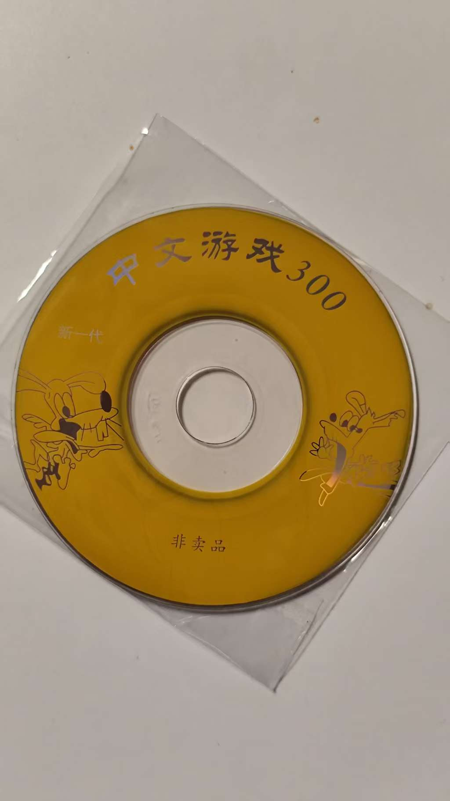

# 【VCD300-GAME Simulator · VCD中文游戏300模拟器】

**把那张黄色光盘里的游戏，重新带回 Windows。**

V1.1 beta · Windows 10 / 11 x64 · 中文界面 · 键盘 / 手柄 · GPL-2.0-or-later

  

## 【还记得“正在下载”吗】

电视调到 AV，光盘放进 VCD 机。画面上是一页十个游戏的中文菜单，按数字选择，再等左上角那几行熟悉的字：

> 选择01  
> 请稍后  
> 正在下载

那时的“下载”，是从光盘里载入游戏。没有商店页面，也不用登录账号，一只手柄、一台电视，就能玩上很久。

这个项目想留下的，正是这段从选游戏到进入游戏的体验：熟悉的菜单、数字选项、翻页方式，还有稍显柔软的画面和声音。让已经不方便再接上电视的那台 VCD 机，在今天的电脑里继续工作。

本项目以《中文游戏300》VCD 光盘为基础，提取原始菜单和游戏数据，并针对原盘程序的特殊指令与图形分页方式进行兼容处理。原盘的 **300 个菜单项，对应 150 款不同游戏**；重复项仍按原盘顺序保留。

## 【当前公开内容】

本仓库公开 **V1.1 beta 的程序源码、构建说明、兼容性研究记录和测试数据**，并展示开发者提供的原始光盘照片。程序源码与构建说明已公开；原始光盘镜像和菜单压缩包见下方【光盘镜像与菜单】。本次提供升级补丁中的预编译主程序；不单独提交提取后的游戏 ROM。

使用可运行版本时，需要在同一目录保留 `VCD300.exe`、内核与依赖 DLL、`menus` 和 `roms`。本仓库的 **Code → Download ZIP 不能代替完整运行目录**。已有 V1.0 beta / V1.0.1 beta 用户可使用下方补丁。

原盘的游戏数据可通过 `source/convert_disc.py` 从下方提供的镜像中提取；菜单素材可使用同处提供的 `menus.7z`。程序默认面向 Windows 10 / 11 x64。

## 【V1.1 beta 下载与更新】

- [下载 V1.1 beta 升级补丁](https://github.com/MattUan/VCD300-CHS-Games-Simulator/raw/refs/heads/main/releases/VCD300-GAME_Simulator_v1.1-beta_patch.zip)
- 适用于已能正常运行的 **V1.0 beta / V1.0.1 beta**。关闭程序，备份旧的 `VCD300.exe`，将补丁内同名文件覆盖到原运行目录即可。源码文件可按需同步。
- 补丁不含内核 DLL、ROM、菜单及开发环境，不能单独运行。保留原运行目录里的这些文件。
- 窗口内游戏画面按 **4:3** 等比例缩放；底部操作区另计。按 **F11** 全屏，隐藏底部按钮与提示，并在宽屏两侧补黑边；再次按 F11 返回。
- 合并 V1.0.1 输入修复：1P / 2P 可分别选择键盘或具体手柄，支持两种混合组合，自定义 SELECT / START 编号对 USB 与 XInput 均生效。
- 标题栏去除中文括号，加入原创黄色光盘与手柄图标。
- [更新记录与验证范围](releases/V1.1-beta.md)。本版只做相关检查，未重跑全量游戏测试；未进行 Windows 实机或实体手柄验收。

## 【光盘镜像与菜单】

提供开发者上传的《中文游戏300》原始光盘镜像，便于复现数据提取过程。

- [下载原始 ISO 压缩包（约 26.7 MiB）](https://github.com/MattUan/VCD300-CHS-Games-Simulator/raw/refs/heads/main/disc/Chinese-Games-300.iso.zip)
- 解压后得到 `Chinese-Games-300.iso`，原始大小 **57,158,304 字节**。
- 镜像 SHA-256：`1998cb8675e6ec10afbf052be9fc1329405a0dcb99708349c0be610c34e42d63`。
- [下载原始菜单压缩包 menus.7z](https://github.com/MattUan/VCD300-CHS-Games-Simulator/raw/refs/heads/main/disc/menus.7z)，含完整30页菜单，解压至程序根目录的 `menus` 文件夹。
- [校验与数据准备说明](disc/README.md)。镜像用于提取 ROM，程序运行时无需挂载。

## 【操作说明】

| 操作 | 默认按键 |
|---|---|
| 选择本页第 1–9 个游戏 | `1–9` |
| 选择本页第 10 个游戏 | `0`，即 **0=10** |
| 上一页 / 下一页 | `−` / `+` |
| 菜单移动 / 确认 | `↑` `↓` / `Enter` |
| 游戏方向 | `↑` `↓` `←` `→` |
| A / B | `F` / `D` |
| SELECT / START | `S` / `Enter` |
| 返回菜单 | `Esc` |
| 全屏 / 窗口 | `F11` |
| 手柄返回菜单 | 同时按住 `SELECT + START` 约 1 秒 |

在【选项】中分别选择 1P / 2P 的键盘或手柄操作方式、具体设备、键盘映射及手柄按钮编号，也可切换仿 VCD 效果。USB 编号对应 joy.cpl；XInput 使用标准逻辑编号，可点【开始检测按键】核对。进入支持双人的游戏后，在游戏标题页由 1P 的 SELECT（部分游戏用方向键）选择双人，再按 START。支持 XInput 手柄和兼容的传统 USB 手柄；不同型号仍需实际测试。

## 【熟悉的感觉，保留一点不完美】

- **同一个窗口，从菜单玩到游戏。** 不弹出第三方模拟器窗口。
- **默认开启仿 VCD 效果。** 菜单采用游戏画面 50% 的仿真强度，游戏画面带有柔化与轻微色彩渗透；声音同步减少高频细节。可一键关闭，已有设置会保留。
- **两秒钟的等待。** 选择游戏后，左上角显示细长宋体 OSD，至少 2 秒且内核准备完成后进入游戏。“正在下载”只是本地加载提示，不会联网下载。
- **切出窗口就暂停。** 失去焦点时停止读取键盘和手柄；进入游戏时处理本窗口输入法，退出或切出后恢复。
- **完整保留原盘菜单顺序。** 包括重复的游戏选项。

画面、声音和 OSD 是对旧设备观感的近似，并非原 VCD 视频、音频电路的精确复刻。

## 【当前版本与问题反馈】

**当前版本为测试版，欢迎大家积极参与测试，如遇bug欢迎在github中提交Issues。**

请通过 [Issues](https://github.com/MattUan/VCD300-CHS-Games-Simulator/issues) 提交问题，尽量附上：

- 游戏编号，例如 `G122`，以及发生问题的菜单页或关卡。
- Windows 版本、键盘或手柄型号、仿 VCD 效果是否开启。
- 从启动程序开始的复现步骤，必要时附截图或短视频。

现有自动回归中，268 个菜单项通过基础指标检查，32 项仍需复查。**这不等于所有游戏已经完成完整游玩和声音验收。** 内核回归结果见 [tests](tests)，本版显示、音频和启动验证概况见下文。

## 【V1.0 beta 验证概况】

菜单仿真强度约为上一版的50%，游戏画面仿真输出保持一致；音频处理完成高频衰减和缓冲连续性检查。G003、G122开启仿真，G199关闭仿真，各完成1200帧同窗运行并正常返回菜单，OSD计时约2秒。未完成逐款人工游玩、实体手柄及音频主观试听。

## 【源码与构建】

| 路径 | 内容 |
|---|---|
| `source/VCD300.cs` | 中文菜单、输入、选项与关于页面 |
| `source/NativePlayer.cs` | 内核调用、画面显示与音频输出 |
| `source/InputDevices.cs` | 独立双人输入路由、USB / XInput 与配置迁移 |
| `source/WindowGeometry.cs` | 4:3 视口和 Windows 缩放约束 |
| `source/AppIcon.*` | 原创图标源码与 Windows 图标资源 |
| `source/headless.cpp` | 原生内核接口与原盘兼容处理 |
| `source/Fetch-Core.ps1` / `core-overrides` | 固定 FCEUX 上游版本及本项目全部内核修改 |
| `source/convert_disc.py` | 原始镜像提取与转换工具 |
| `disc` | 原盘 ISO 压缩包与30页菜单压缩包，含校验和准备说明 |
| `menus` / `roms`（解压或提取生成） | 程序运行所需的菜单与游戏数据 |
| `licenses` | 第三方许可和版权声明 |

在 Windows PowerShell 中执行 `./source/Build-App.ps1` 可重新编译界面程序。原生内核先执行 `./source/Fetch-Core.ps1` 获取固定版本 FCEUX 并应用本项目的 8 个修改文件，再使用 Visual Studio C++ 工具链、Windows SDK 和 Python 构建，详细步骤见 [source/README.md](source/README.md)。原盘结构与兼容处理见[逆向记录](source/REVERSE-ENGINEERING.md)。

## 【开发者与开源许可】

开发者：[MattUan](https://github.com/MattUan)。

模拟器内核基于 **FCEUX 2.7.0**，感谢 FCEUX 团队及其贡献者。软件源码按 **GNU GPL v2 或更新版本（GPL-2.0-or-later）** 提供，详见 [LICENSE](LICENSE) 和 [licenses](licenses)。第三方组件按各自许可提供。

可运行版本所用游戏 ROM 与原始菜单提取自《中文游戏300》VCD 光盘；游戏数据以原始镜像形式提供，需自行提取 ROM 并解压菜单压缩包。光盘照片由开发者提供。**软件的开源许可不代表游戏 ROM、光盘图像或原盘素材的再分发授权**；这些内容的权利归其各自权利人所有。

希望你再次按下 START 时，还能想起电视机前那个下午。

